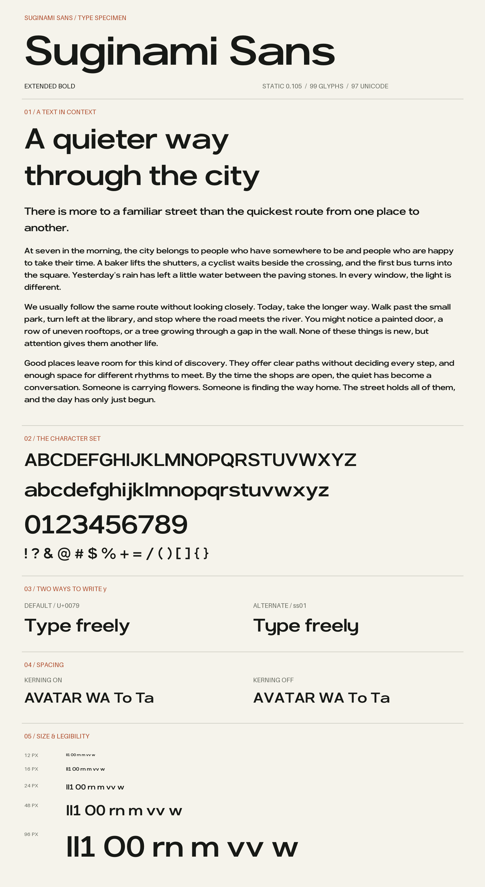

# Suginami Sans

横に広い字形、広い内側の空間、太い縦線と水平な端部を持つ独自書体です。現在のスタイルは静的 **Extended Bold 0.105** です。



## ダウンロードと見本

[GitHub Release v0.105](https://github.com/ojimpo/suginami-sans/releases/tag/v0.105) に、OTF／TTF・見本付きZIP・画像見本・SHA-256チェックサムをまとめています。現在はprivateのため、取得にはアクセス権のあるGitHubアカウントが必要です。

ZIPには、見出し・リード・187語の3段落を組んだ画像とHTMLの見本を収録しています。HTMLでは本文16／24／32px、行間1.3／1.6／1.9、自由入力、通常y／代替y、カーニング、OTF／TTF、反転を比較できます。

`fonts/` のOTFまたはTTFを利用できます。両形式は同じ書体です。印字可能ASCII95文字とen/em dash、未符号化の代替yを収録し、全99グリフ・97 Unicodeです。日本語やアクセント付き文字は未収録です。

通常yはU+0079です。スタイルセット1（ss01、フォント内の表示名は「Logo y」）で代替字形へ切り替えます。代替字形にも通常の `y` を入力します。

```css
@font-face {
  font-family: "Suginami Sans";
  src: url("SuginamiSans-ExtendedBold.otf") format("opentype");
  font-weight: 700;
  font-style: normal;
}
.suginami { font-family: "Suginami Sans", sans-serif; font-weight: 700; font-kerning: normal; font-synthesis: none; }
.alternate-y { font-feature-settings: "ss01" 1; }
```

利用方法は [docs/USAGE.md](docs/USAGE.md)、制作経緯は [docs/PROVENANCE.md](docs/PROVENANCE.md) を参照してください。**一般向けの配布ライセンスと公開は未決定です。** このリポジトリの準備は一般公開・再配布の許諾を意味しません。

## ビルドと検証

Python 3.12以上を使い、依存はプロジェクト内の仮想環境へ入れます。Windowsの例：

```powershell
python -m venv .venv
.\.venv\Scripts\python.exe -m pip install -r requirements-font.txt
.\.venv\Scripts\python.exe scripts/build_fonts.py
.\.venv\Scripts\python.exe scripts/validate.py
.\.venv\Scripts\python.exe scripts/validate_fonts.py
.\.venv\Scripts\python.exe scripts/check_reproducibility.py
.\.venv\Scripts\python.exe scripts/make_proofs.py
# 任意のNode.js + Playwright + Microsoft Edgeでブラウザ確認
node scripts/verify_specimen.cjs
.\.venv\Scripts\python.exe scripts/package_release.py
```

macOS/LinuxではPythonのパスを `.venv/bin/python` に置き換えます。編集用原本は `source/SuginamiSans-ExtendedBold.ufo/` です。通常ビルドはこのUFOを読み、JSONから原本を上書きしません。

比較見本は `proofs/index.html`。ルートで `python -m http.server 8766 --bind 127.0.0.1` を実行して `http://127.0.0.1:8766/proofs/` を開くと、自由入力・OTF/TTF・ss01・カーニング・サイズを試せます。

元のJSONから新しいUFOを作る手順と検証範囲は [docs/BUILD.md](docs/BUILD.md)、実行記録と限界は [docs/VALIDATION.md](docs/VALIDATION.md) にあります。標準幅・Regular・バリアブル版は未設計です。
